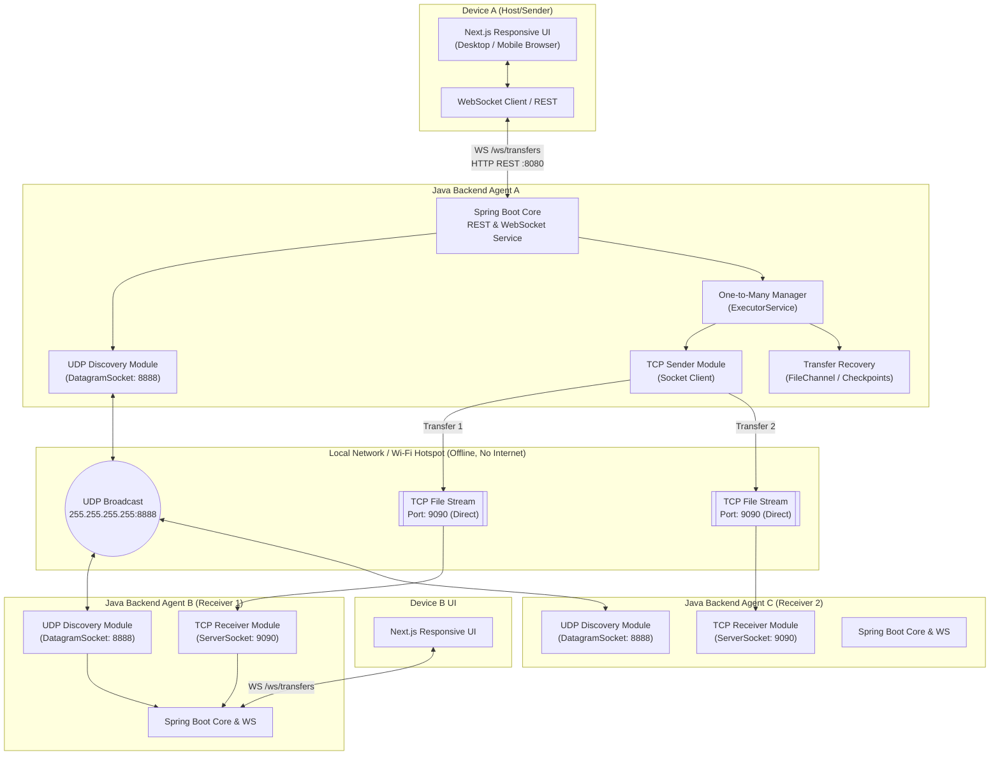
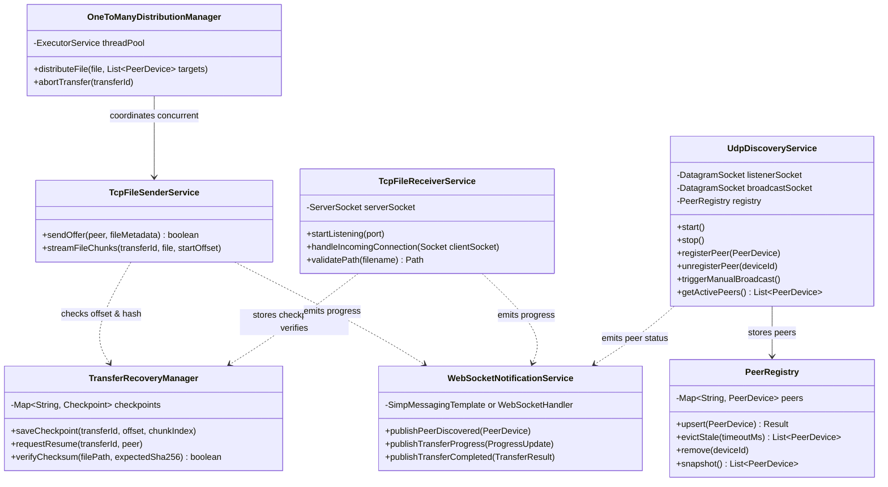

# OmniDrop – System Architecture Specification

## 1. High-Level Architecture Overview

OmniDrop is architected as a distributed local-network system where each node pairs a **Java Network Programming Agent** with a modern **Next.js Web Frontend**. 

Standard browser sandboxes prohibit direct access to raw TCP/UDP sockets. To preserve authentic Java network programming while delivering an intuitive browser UI across desktop, tablet, and mobile devices, each participating node runs the Java backend agent locally.

---

## 2. Multi-Protocol Tiering

OmniDrop cleanly separates concerns across four distinct protocol layers:

| Layer | Protocol | Role in OmniDrop | Implementation |
| :--- | :--- | :--- | :--- |
| **Discovery** | **UDP Sockets** | Dynamic peer beaconing, heartbeat, node leave | `DatagramSocket`, `DatagramPacket` |
| **Data Transfer** | **TCP Sockets** | Reliable chunked binary file streaming, framing, ACKs | `Socket`, `ServerSocket`, `FileChannel` |
| **Local Real-Time** | **WebSockets** | Instant transfer progress, speeds, active peer table | Spring WebSocket handler (`/ws/transfers`) |
| **Control / Config** | **HTTP REST** | File upload to agent, transfer initiation, cancel commands | Spring Boot REST Controllers (`/api/v1/...`) |

---

## 3. Core Backend Modular Architecture

The Java backend (`com.omnidrop`) is structured into clean, decoupled modules designed for group collaboration:

---

## 4. Frontend Architecture (Next.js App Router)

The frontend is a single-page reactive application built with Next.js App Router, TypeScript, and Tailwind CSS.

- **`app/page.tsx`**: Unified responsive dashboard displaying system health, discovery table, active transfers, and one-to-many launcher.
- **`app/discovery/page.tsx`**: Dedicated real-time radar and peer device manager.
- **`app/transfer/page.tsx`**: Single-file upload and point-to-point transfer console.
- **`app/distribution/page.tsx`**: One-to-many broadcast console with individual target progress monitors.
- **`app/recovery/page.tsx`**: Checkpoint inspector and manual/automatic resume center.
- **`hooks/useWebSocket.ts`**: Reconnecting WebSocket listener that dispatches real-time events into local React states.
- **`services/api.ts`**: Clean REST client interfacing with the local Java backend.
