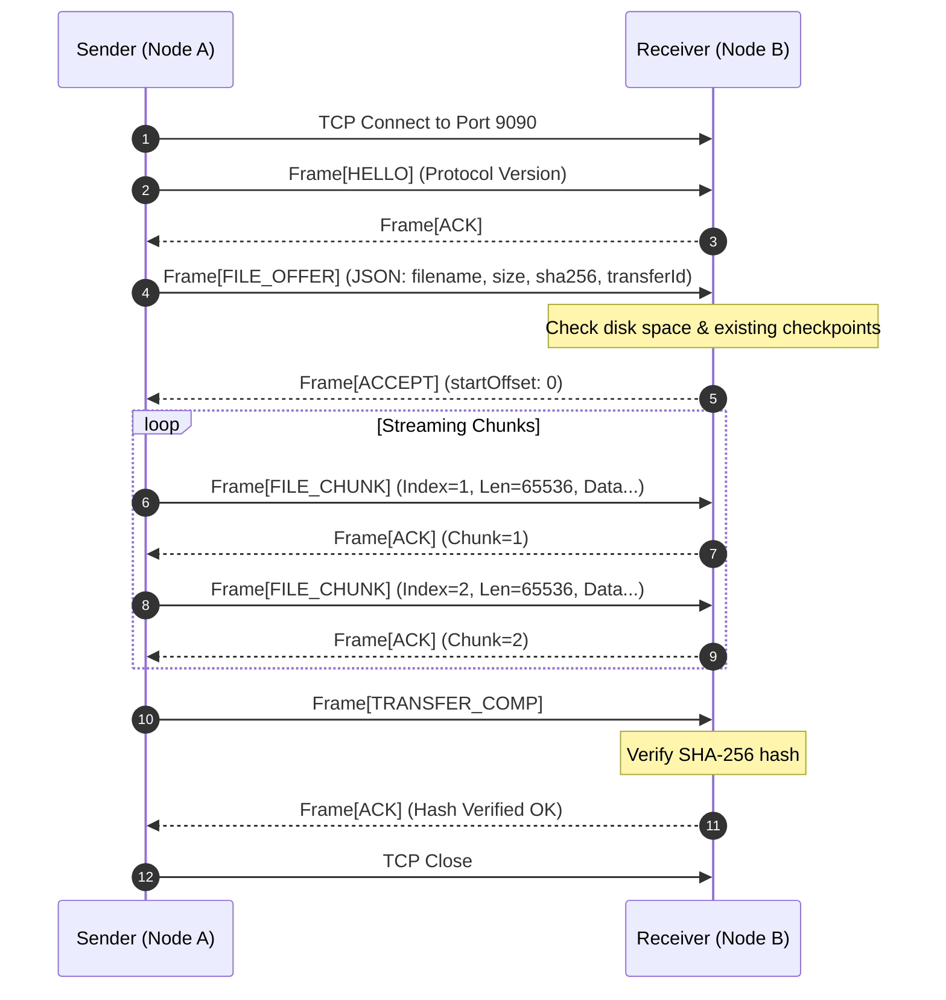
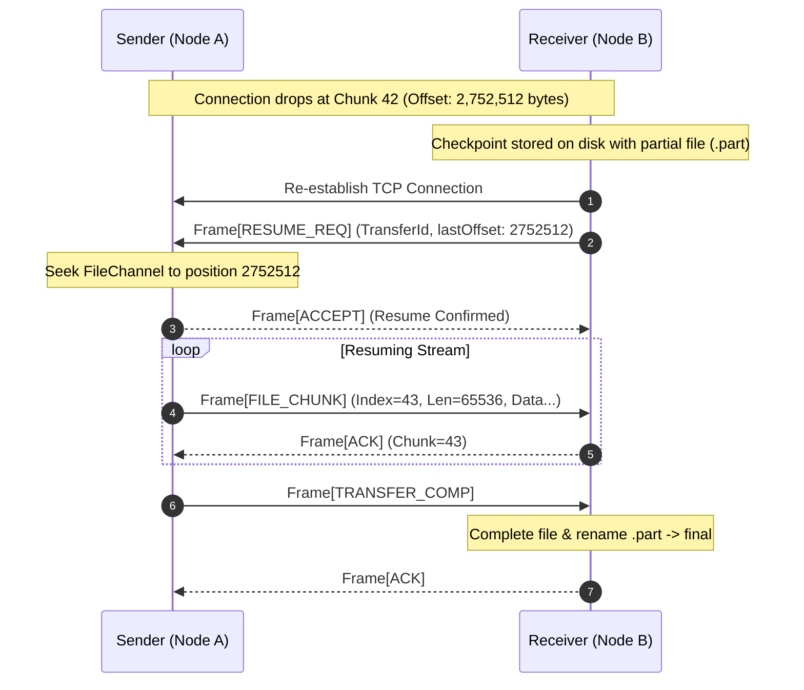

# OmniDrop – Network Protocol Specification

This document defines the exact on-the-wire protocols used by OmniDrop:
1. **UDP Device Discovery Protocol** (Broadcast Datagrams)
2. **Framed TCP File Transfer Protocol** (Reliable Stream Framing)

---

## 1. UDP Device Discovery Protocol

### 1.1 Specification
- **Default Broadcast Port**: `8888`
- **Transport**: UDP (`DatagramSocket`, `DatagramPacket`)
- **Broadcast Address**: `255.255.255.255` (and interface-specific subnet broadcasts)
- **Interval**: Nodes broadcast their presence every 3 seconds.
- **Node Expiry**: Any peer unseen for 10 seconds is flagged inactive and removed.

### 1.2 Beacon Payload Format (JSON over UDP)
To ensure broad cross-platform interoperability, UDP discovery datagrams transmit a compact JSON packet:

```json
{
  "magic": "OMNI_DISCOVER",
  "version": 1,
  "deviceId": "d4a123f0-781e-4512-b5e1-88c9f0a2139b",
  "deviceName": "Alice-ThinkPad",
  "tcpPort": 9090,
  "httpPort": 8080,
  "timestamp": 1731254400000
}
```

### 1.3 Validation Rules
1. Packets without `"magic": "OMNI_DISCOVER"` MUST be discarded immediately.
2. Receiver obtains the sender's real IP address directly from `DatagramPacket.getAddress().getHostAddress()`.
3. If `deviceId` matches the local node's own ID, the packet is ignored (self-loopback suppression).

---

## 2. Framed TCP File Transfer Protocol

TCP is a stream-oriented protocol without inherent message boundaries. OmniDrop implements an explicit **binary length-prefixed framing format** to ensure that chunks, headers, and commands are parsed deterministically.

### 2.1 Binary Frame Structure

Every TCP frame transmitted between sender and receiver adheres to this 20-byte fixed header followed by a variable-length payload:

```
 0                   1                   2                   3
 0 1 2 3 4 5 6 7 8 9 0 1 2 3 4 5 6 7 8 9 0 1 2 3 4 5 6 7 8 9 0 1
+-+-+-+-+-+-+-+-+-+-+-+-+-+-+-+-+-+-+-+-+-+-+-+-+-+-+-+-+-+-+-+-+
|       Magic (0x4F, 0x4D, 0x4E, 0x49) -> "OMNI"                |
+-+-+-+-+-+-+-+-+-+-+-+-+-+-+-+-+-+-+-+-+-+-+-+-+-+-+-+-+-+-+-+-+
|  Version (1)  |  Opcode (1)   |         Reserved (2B)         |
+-+-+-+-+-+-+-+-+-+-+-+-+-+-+-+-+-+-+-+-+-+-+-+-+-+-+-+-+-+-+-+-+
|                      Chunk Index (4 Bytes)                    |
+-+-+-+-+-+-+-+-+-+-+-+-+-+-+-+-+-+-+-+-+-+-+-+-+-+-+-+-+-+-+-+-+
|                      Payload Length (4 Bytes)                 |
+-+-+-+-+-+-+-+-+-+-+-+-+-+-+-+-+-+-+-+-+-+-+-+-+-+-+-+-+-+-+-+-+
|                      CRC32 Checksum (4 Bytes)                 |
+-+-+-+-+-+-+-+-+-+-+-+-+-+-+-+-+-+-+-+-+-+-+-+-+-+-+-+-+-+-+-+-+
|                        Payload Data ...                       |
|               (Variable Length = Payload Length)              |
+-+-+-+-+-+-+-+-+-+-+-+-+-+-+-+-+-+-+-+-+-+-+-+-+-+-+-+-+-+-+-+-+
```

### 2.2 Field Definitions
1. **Magic (4 Bytes)**: Fixed byte sequence `0x4F 0x4D 0x4E 0x49` (ASCII: `"OMNI"`). If unaligned, connection is aborted.
2. **Version (1 Byte)**: `0x01` (Protocol Version 1).
3. **Opcode (1 Byte)**: Defines frame intention (see table below).
4. **Reserved (2 Bytes)**: Padded zeros `0x00 0x00`.
5. **Chunk Index (4 Bytes)**: Big-endian integer. 0 for metadata/control frames; `1, 2, 3...` for data chunks.
6. **Payload Length (4 Bytes)**: Big-endian integer specifying exact number of subsequent payload bytes.
7. **CRC32 (4 Bytes)**: Checksum computed over the payload data for per-frame integrity.
8. **Payload Data**: Raw data or JSON metadata string.

### 2.3 Opcode Table

| Opcode | Hex | Mnemonic | Description |
| :--- | :--- | :--- | :--- |
| 1 | `0x01` | `HELLO` | Sender initiates handshake and declares protocol version |
| 2 | `0x02` | `FILE_OFFER` | Sender transmits JSON file metadata (name, size, SHA-256) |
| 3 | `0x03` | `ACCEPT` | Receiver consents to receive file, returns byte offset (0 if new) |
| 4 | `0x04` | `REJECT` | Receiver declines file (e.g. disk full, user declined) |
| 5 | `0x05` | `FILE_CHUNK` | Sender transmits raw binary slice of the file (default 64 KB) |
| 6 | `0x06` | `ACK` | Receiver acknowledges receipt of chunk index |
| 7 | `0x07` | `RESUME_REQ` | Reconnecting receiver requests transfer resumption from offset |
| 8 | `0x08` | `TRANSFER_COMP`| Sender signals end-of-file; receiver validates SHA-256 |
| 9 | `0x09` | `ERROR` | Abort frame with error code and human-readable message |

---

## 3. Communication Sequences

### 3.1 Standard Point-to-Point Transfer Sequence



---

### 3.2 Interrupted Transfer Recovery Sequence


